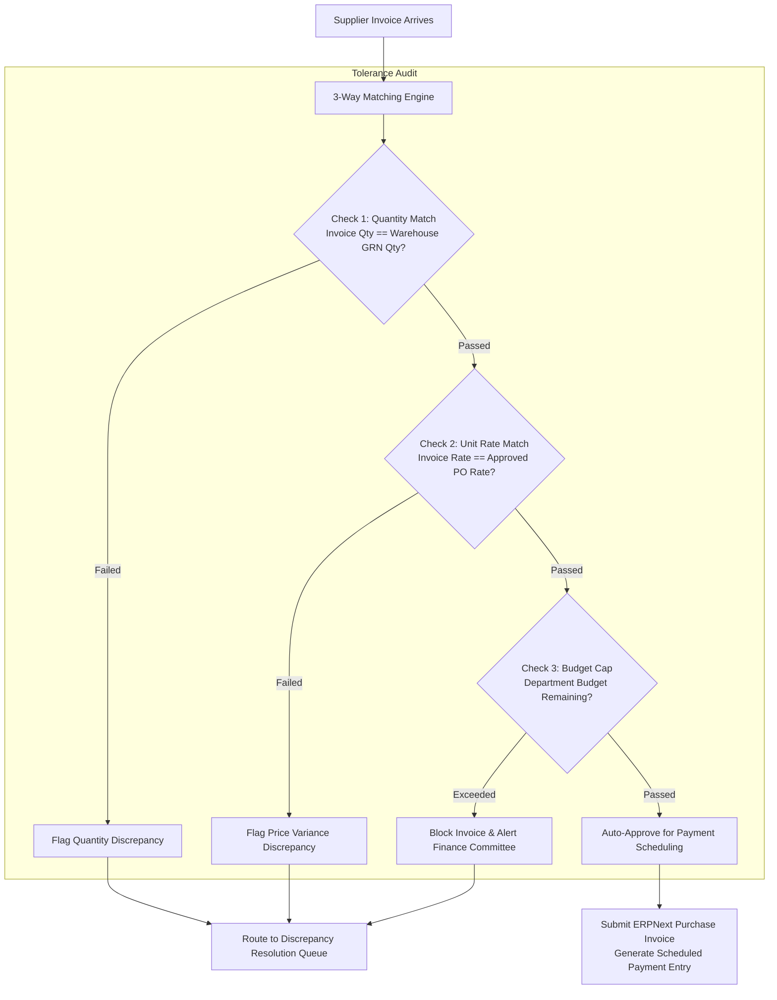

# Frappe 3-Way Purchase Order Matching & Expense Budgeting Engine

[](https://www.python.org/)
[](https://frappe.io)
[](https://erpnext.com)
[](LICENSE)
[](https://frappe.io)
[]()

Enterprise **Procurement Audit & Budget Control Engine** for **Frappe & ERPNext**. Automates algorithmic **3-Way Matching** between **Purchase Orders (PO)**, **Warehouse Goods Receipt Notes (GRN)**, and **Supplier Invoices (PI)**, backed by real-time departmental expense budget enforcement.

---

## 🎯 The Real-World Client Problem

Procurement leakage and unbudgeted expenditures drain enterprise cash reserves:
1. **Paying for Undelivered Goods:** Accounts departments often pay vendor bills without verifying if warehouse staff actually received the full quantity specified on the invoice.
2. **Sneaky Price Variance:** Suppliers sometimes quote one price on the Purchase Order, but bill at a higher rate on the final invoice. In manual verification, price creep goes unnoticed.
3. **Departmental Budget Overruns:** Marketing, IT, and Admin departments frequently commit to vendor contracts that exceed annual allocated budgets because there is no automated blocking mechanism.

**This engine automates strict 3-Way Matching:** Every supplier invoice is checked against the approved Purchase Order and verified Warehouse Goods Receipt Notes. Invoices that match within configured tolerance limits are auto-approved, while variances trigger escalation workflows.

---

## 🏗️ System Architecture & Data Flow



---

## ⚙️ Key Enterprise Features

- **Automated Algorithmic 3-Way Match:** Evaluates line-item quantities, unit rates, tax amounts, and payment terms across Purchase Orders, Goods Receipts, and Invoices.
- **Configurable Variance Tolerances:** Allows acceptable threshold variances (e.g. ±1% for weight tolerances in raw materials) while strictly flagging unauthorized price hikes.
- **Departmental Budget Enforcement:** Validates current departmental spend against monthly and annual budget allocations, preventing cost center overruns before invoice submission.
- **Automated Approval Routing:** Invoices with 100% match compliance skip manual review and move straight to payment scheduling, cutting accounts processing time by 80%.
- **Discrepancy Escalation Dashboard:** Consolidates mismatched vendor bills into an action-oriented resolution queue for procurement officers.

---

## 📂 Project Structure

```
frappe-automated-purchase-expense-tracker/
├── procure_expense/
│   ├── __init__.py           # Module initialization
│   └── engine.py             # 3-Way matching & expense budgeting engine
├── tests/
│   ├── __init__.py
│   └── test_procure.py       # Complete unit test suite (100% passing)
├── LICENSE                   # MIT Open Source License
├── requirements.txt          # Python dependencies
└── README.md                 # Complete documentation
```

---

## 🔌 Frappe DocType Schema Design

- **`Procurement Matching Rule`:** Tolerance % for Quantity, Tolerance % for Unit Price, and Auto-Approval Threshold.
- **`Department Expense Budget Cap`:** Fiscal Year, Department (IT, Marketing, Logistics), Allocated Budget INR, Consumed Spend, and Alert Threshold.
- **`3-Way Match Audit Log`:** Purchase Invoice ID, PO Reference, GRN Reference, Quantity Variance, Rate Variance, Match Status, and Decision.

---

## 🚀 Installation & Setup

### 1. Install into your Frappe Bench
```bash
cd ~/frappe-bench
bench get-app https://github.com/shyampandey1104/frappe-automated-purchase-expense-tracker.git
bench --site [your-site-name] install-app frappe_procure_expense
```

### 2. Python Usage Example
```python
from procure_expense.engine import ThreeWayMatchingEngine, PurchaseOrderLine, GoodsReceiptLine, SupplierInvoiceLine

# 1. Initialize engine with tolerance settings
engine = ThreeWayMatchingEngine(allowed_price_variance_pct=0.5, allowed_qty_variance_pct=0.0)

# 2. Define 3-way inputs
po_line = PurchaseOrderLine(item_code="RAW-STEEL-COIL", ordered_qty=100.0, agreed_rate=550.0)
grn_line = GoodsReceiptLine(item_code="RAW-STEEL-COIL", received_qty=100.0)
inv_line = SupplierInvoiceLine(item_code="RAW-STEEL-COIL", billed_qty=100.0, billed_rate=550.0)

# 3. Execute 3-way match
match_result = engine.execute_three_way_match(po_line, grn_line, inv_line)
print(f"Match Status: {match_result.status}")  # MATCH_VERIFIED_AUTO_APPROVE
print(f"Can Settle Invoice? {match_result.is_approved_for_payment}")
```

---

## 🧪 Testing & Verification

Run tests with standard Python:
```bash
python3 -m unittest discover tests
```

---

## 🛡️ Corporate Governance & SOX Compliance
- Provides a transparent, tamper-proof audit trail for internal and statutory auditors, satisfying **Sarbanes-Oxley (SOX)** and institutional procurement controls.

---

## 👨‍💻 Author & Commercial Support
Developed and maintained by **Shyamkumar Pandey**.  
For enterprise procurement workflows, supply chain controls, and ERPNext customizations:
- **GitHub:** [@shyampandey1104](https://github.com/shyampandey1104)
- **Email:** [shyampandey1104@gmail.com](mailto:shyampandey1104@gmail.com)
